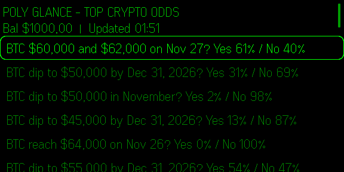
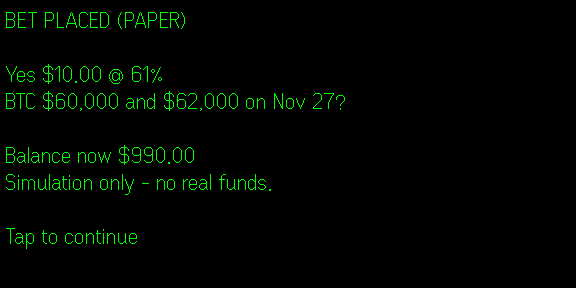

# Poly Glance — Polymarket odds at a glance on Even Realities G2

> **Heads Up: Even Realities Hackathon** (DoraHacks) · Track **02 · Crypto & DeFi** · Build week 23–29 Nov 2026

Check live Polymarket crypto odds with a glance — no phone in hand, no wallet, no real money. Tap the temple (or speak) to see a market, place a **paper bet**, or check your watchlist. Built for the 576×288 monochrome-green G2 display: one important thing on screen, few words, high contrast.

## What it does

- **Home — Top crypto odds (live).** Top 12 crypto markets by 24h volume from the Polymarket Gamma API, with Yes/No (or Up/Down) odds. Auto-refreshes every 60 seconds.
- **Detail — Odds + paper bet.** Tap a market: live odds, 24h volume, end date. Bet **$10 / $50 of play money** on either side, or add it to the watchlist.
- **Paper bets — simulation only.** You start with **$1,000 of virtual USD**. Bets are marked against live prices (`current value = stake × live price / entry price`). No wallet, no transaction, no real funds — ever.
- **Watchlist.** Star markets and jump back to them in one tap.
- **Voice.** Long-press anywhere and say: *top, watchlist, bets, refresh, back, yes, no,* or a market number. Mic via the G2 four-mic array; speech-to-text via the Web Speech API when the WebView provides it (otherwise the mic still opens and the tap path remains — see Limitations).

## Screenshots (simulator, 576×288 glasses canvas)





Demo video: `docs/demo.mp4` (84 s, silent simulator capture — narration in
[`demo-script.md`](demo-script.md)).

## Data — real, no mocks

- Primary: `GET https://gamma-api.polymarket.com/events?tag_slug=crypto&active=true&closed=false` (flattened to markets, sorted by 24h volume). Verified 27 Nov 2026: the tag filter works on `/events` but is ignored on `/markets`, so the app filters client-side as a fallback.
- Fallback: `GET /markets?active=true&closed=false&limit=60&order=volume24hr` + client-side crypto keyword filter.
- If Gamma is unreachable the app shows an explicit error screen with retry — **it never renders mock data**.
- Gamma sends `Access-Control-Allow-Origin: *`, so the WebView can call it directly; the domain is whitelisted in `app.json` (`network` permission). No API key exists or is shipped.

## Quickstart (simulator — no glasses needed)

```bash
npm install -g @evenrealities/evenhub-cli @evenrealities/evenhub-simulator
# (Linux) the simulator needs WebKitGTK:
#   sudo apt-get install -y libwebkit2gtk-4.1-0

npm install
npm run dev            # Terminal 1 — Vite on http://localhost:5173

evenhub-simulator http://localhost:5173   # Terminal 2 — glasses canvas
# Headless VM: xvfb-run -a -s "-screen 0 1280x800x24" evenhub-simulator http://localhost:5173
# Scripted input: evenhub-simulator --automation-port 9898 http://localhost:5173
#   POST /api/input {"action":"click"|"double_click"|"up"|"down"|"long_press"|"long_press_release"}
#   GET  /api/screenshot/glasses   (PNG 576x288)   GET /api/console
```

Browser preview (no bridge): open `http://localhost:5173` in any browser — the green box mirrors the glasses screen; the buttons below it simulate taps.

## How to use on G2

| Gesture | Action |
|---|---|
| Tap (temple / R1 ring) | Select the highlighted list item · on text screens: go back |
| Swipe up / down | Scroll the list (firmware highlight) |
| Double-tap on Home | Exit (system confirmation dialog, as required) |
| Double-tap elsewhere | Back to Home |
| Long-press | Listen for a voice command, release to stop |

## Screens

1. **Home** — list: top crypto markets + `WATCHLIST (n)` + `PAPER BETS` + `REFRESH ODDS`.
2. **Detail** — header: question, both odds, 24h volume, end date; actions: bet $10/$50, watchlist add/remove, back.
3. **Watchlist / Paper bets** — lists with live values; tap an entry for detail.
4. **Confirm** — paper-bet receipt (balance after the bet); tap to continue.
5. **Listening** — voice-command overlay.

## Project structure

```
app.json                 Even Hub manifest (package com.erjeganteng3.polyglance)
src/main.ts              Screens, navigation, events, voice commands
src/glance.ts            SDK containers (text/list pages, 576x288) + DOM mirror
src/polymarket.ts        Gamma API client + formatting (ASCII only — G2 font)
src/store.ts             Paper balance / bets / watchlist (bridge localStorage)
index.html               Vite entry + 576x288 browser-preview mirror
scripts/sim-test.sh      Xvfb + dev server + simulator harness
scripts/e2e.sh           Scripted end-to-end test via the automation API
scripts/record-demo.sh   Records the 3-minute demo video (X11 capture)
```

## Packaging

```bash
npm run build
evenhub pack app.json dist -o poly-glance.ehpk
```

(`evenhub login` / `create` / `upload` need a developer account — not done here.)

## What existed before 23 Nov 2026

Nothing of this app. It was built during the hackathon build week (23–29 Nov 2026) from the official Vite + TypeScript scaffold (`npm create vite -- --template vanilla-ts`) plus the official Even Hub SDK (`@evenrealities/even_hub_sdk@0.0.16`) and the standard `evenhub init` manifest. All app logic, screens, data integration, and tests are new work from build week.

## Limitations (honest notes)

- **Voice ASR** depends on the Web Speech API being present in the host WebView. The Even App WebView may not provide it — in that case the mic still opens (PCM capture via the SDK) and the app says so on screen; every voice command also exists as a tap. A production build would route mic audio to a server-side STT.
- **No G2 hardware was available** — tested only in the official simulator (v0.9.5) on Linux + the browser preview. Real-glasses checks (QR sideload, temple tap feel, brightness) are still open.
- Lists cap at 20 items (firmware); the app shows 12 markets + 3 actions.
- Paper bets never resolve to won/lost automatically — Polymarket resolution needs the CLOB/UMA oracle; bets show live paper value until the market closes, then freeze.
- Dev-only URL flag `?reset=1` clears paper state (used for clean demo recordings).

## Safety

No account, no sign-in, no wallet connection, no private key, no API key, no funds. The app only performs unauthenticated `GET` requests to a public API and stores play-money state locally on the phone.

## License

MIT.
